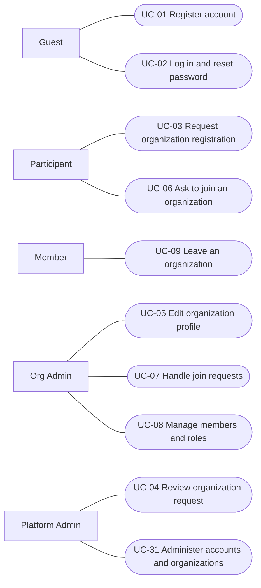
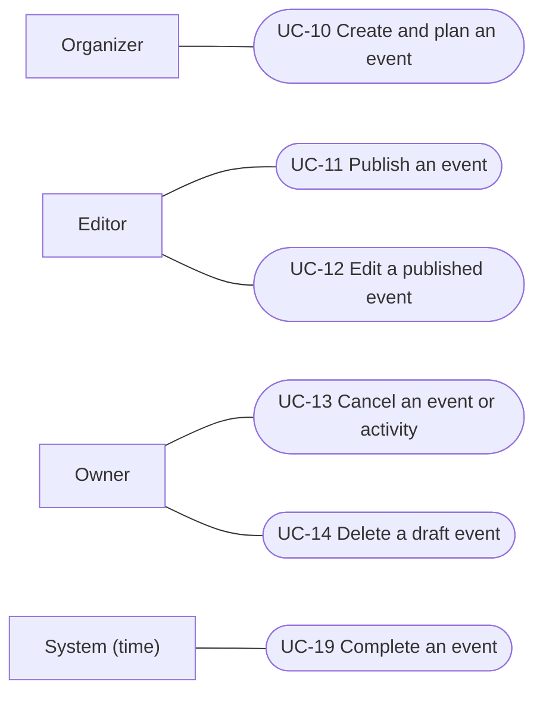
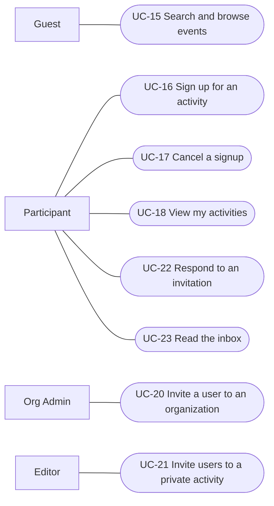
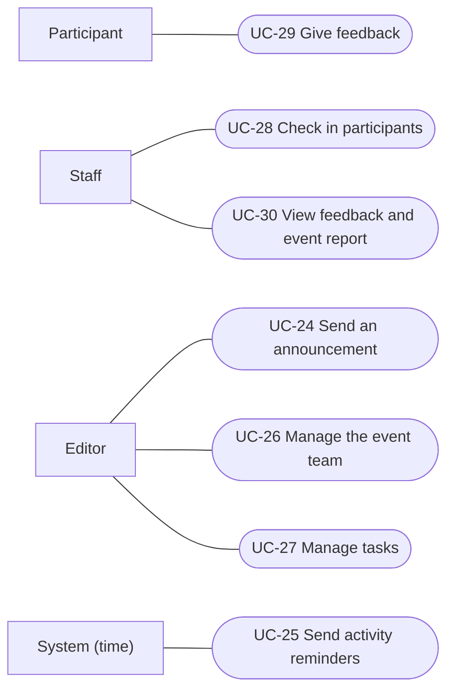

# Use Cases

The primary actor is the lowest role that can perform the use case; higher roles inherit it (see [Actors and Roles](03-actors-and-roles.md)). **System (time)** marks behaviour triggered automatically by time.

## Catalogue

| ID | Use case | Primary actor | Requirements | Milestone |
|---|---|---|---|---|
| UC-01 | Register account | Guest | FR-ACC-01, FR-ACC-02 | Mid-term |
| UC-02 | Log in and reset password | Guest | FR-ACC-03 | Mid-term |
| UC-03 | Request organization registration | Participant | FR-ORG-01 | Mid-term |
| UC-04 | Review organization request | Platform Admin | FR-ORG-02 | Mid-term |
| UC-05 | Edit organization profile | Org Admin | FR-ORG-03 | Mid-term |
| UC-06 | Ask to join an organization | Participant | FR-ORG-04 | Mid-term |
| UC-07 | Handle join requests | Org Admin | FR-ORG-04 | Mid-term |
| UC-08 | Manage members and roles | Org Admin | FR-ORG-06 | Mid-term |
| UC-09 | Leave an organization | Member | FR-ORG-07 | Mid-term |
| UC-10 | Create and plan an event | Organizer | FR-EVT-01, FR-EVT-02, FR-EVT-03 | Mid-term |
| UC-11 | Publish an event | Editor | FR-EVT-04 | Mid-term |
| UC-12 | Edit a published event | Editor | FR-EVT-05, FR-NTF-03 | Mid-term |
| UC-13 | Cancel an event or activity | Owner | FR-EVT-06, FR-NTF-03 | Mid-term |
| UC-14 | Delete a draft event | Owner | FR-EVT-07 | Mid-term |
| UC-15 | Search and browse events | Guest | FR-DSC-01 – FR-DSC-04 | Mid-term |
| UC-16 | Sign up for an activity | Participant | FR-REG-01, FR-REG-02, FR-REG-05 | Mid-term |
| UC-17 | Cancel a signup | Participant | FR-REG-03, FR-REG-04, FR-NTF-04 | Mid-term |
| UC-18 | View my activities | Participant | FR-DSC-05 | Mid-term |
| UC-19 | Complete an event | System (time) | FR-EVT-08 | Mid-term |
| UC-20 | Invite a user to an organization | Org Admin | FR-ORG-05 | Final |
| UC-21 | Invite users to a private activity | Editor | FR-PRV-01, FR-PRV-02 | Final |
| UC-22 | Respond to an invitation | Participant | FR-PRV-03, FR-ORG-05 | Final |
| UC-23 | Read the inbox | Participant | FR-NTF-01, FR-NTF-02 | Final |
| UC-24 | Send an announcement | Editor | FR-NTF-05 | Final |
| UC-25 | Send activity reminders | System (time) | FR-NTF-06 | Final |
| UC-26 | Manage the event team | Editor | FR-TEAM-01, FR-TEAM-02 | Final |
| UC-27 | Manage tasks | Editor | FR-TEAM-03, FR-TEAM-04 | Final |
| UC-28 | Check in participants | Staff | FR-ATT-01 – FR-ATT-03 | Final |
| UC-29 | Give feedback | Participant | FR-FBK-01 | Final |
| UC-30 | View feedback and event report | Staff | FR-FBK-02, FR-RPT-01, FR-RPT-02 | Final |
| UC-31 | Administer accounts and organizations | Platform Admin | FR-ACC-04, FR-ACC-05, FR-ORG-08 | Final |

## Diagrams

### Accounts and organizations

### Events

### Discovery, registration and invitations

### Event operations

## Specifications

### UC-01 Register account

**Actor:** Guest · **Milestone:** Mid-term · **Requirements:** FR-ACC-01, FR-ACC-02 · **Rules:** BR-20

**Preconditions:** None.

**Main flow:**
1. Guest enters email, password, username and display name.
2. System checks that the username is not taken.
3. System creates an unconfirmed account and sends a confirmation email.
4. Guest confirms the email through the link.
5. System activates the account.

**Alternative flows:**
- 2a. Username taken: system asks for another.
- 3a. Email already registered: system sends that address a notice instead of a confirmation, and shows the Guest the same message as for a new registration.
- 4a. Link expired: Guest requests a new confirmation email.

**Postcondition:** The account is active; the user is a Participant.

---

### UC-02 Log in and reset password

**Actor:** Guest · **Milestone:** Mid-term · **Requirements:** FR-ACC-03

**Preconditions:** The account exists.

**Main flow:**
1. Guest enters email and password.
2. System verifies the credentials and starts a session.

**Alternative flows:**
- 1a. Forgotten password: Guest requests a reset; system emails a reset link; Guest sets a new password.
- 2a. Wrong credentials: system refuses without saying which one is wrong.
- 2b. Account unconfirmed or deactivated: system refuses and states the reason.

**Postcondition:** The user is logged in and can log out at any time.

---

### UC-03 Request organization registration

**Actor:** Participant · **Milestone:** Mid-term · **Requirements:** FR-ORG-01

**Preconditions:** Participant is logged in.

**Main flow:**
1. Participant enters the organization's name, description and contact email.
2. System checks that no active organization or pending request uses the name.
3. System records the request as Pending.

**Alternative flows:**
- 2a. Name in use: system refuses.

**Postcondition:** The request is Pending and visible to Platform Admins.

---

### UC-04 Review organization request

**Actor:** Platform Admin · **Milestone:** Mid-term · **Requirements:** FR-ORG-02

**Preconditions:** A request is Pending.

**Main flow:**
1. Platform Admin opens a pending request.
2. Platform Admin approves it.
3. System creates the organization and makes the requester its Org Admin.

**Alternative flows:**
- 2a. Platform Admin rejects it with a reason; system records the request as Rejected and shows the reason to the requester.

**Postcondition:** The organization is active, or the request is rejected.

---

### UC-05 Edit organization profile

**Actor:** Org Admin · **Milestone:** Mid-term · **Requirements:** FR-ORG-03

**Preconditions:** Actor is Org Admin of the organization.

**Main flow:**
1. Org Admin changes the name, description or contact email.
2. System validates and saves the changes.

**Alternative flows:**
- 2a. Name used by another organization: system refuses.

**Postcondition:** The profile is updated.

---

### UC-06 Ask to join an organization

**Actor:** Participant · **Milestone:** Mid-term · **Requirements:** FR-ORG-04

**Preconditions:** Participant is logged in and not a member of the organization.

**Main flow:**
1. Participant asks to join the organization.
2. System records a pending join request.

**Alternative flows:**
- 1a. A request is already pending: system shows it; Participant may withdraw it.

**Postcondition:** A join request is pending.

---

### UC-07 Handle join requests

**Actor:** Org Admin · **Milestone:** Mid-term · **Requirements:** FR-ORG-04

**Preconditions:** The organization has pending join requests.

**Main flow:**
1. Org Admin views the pending join requests.
2. Org Admin approves a request.
3. System adds the user as Member.

**Alternative flows:**
- 2a. Org Admin rejects the request; the user may ask again later.

**Postcondition:** The user is a Member, or the request is rejected.

---

### UC-08 Manage members and roles

**Actor:** Org Admin · **Milestone:** Mid-term · **Requirements:** FR-ORG-06 · **Rules:** BR-21, BR-22, BR-23

**Preconditions:** Actor is Org Admin of the organization.

**Main flow:**
1. Org Admin views the members and their roles.
2. Org Admin sets a member's role to Member, Organizer or Org Admin.
3. System saves the change.

**Alternative flows:**
- 2a. Org Admin removes a member: system removes the membership and the member's event-team roles.
- 2b. The change or removal would leave no Org Admin: system refuses.
- 2c. The member owns a draft or published event: removal is refused until ownership is transferred.

**Postcondition:** Roles and membership are updated.

---

### UC-09 Leave an organization

**Actor:** Member · **Milestone:** Mid-term · **Requirements:** FR-ORG-07 · **Rules:** BR-21, BR-22, BR-23

**Preconditions:** Actor is a member of the organization.

**Main flow:**
1. Member chooses to leave the organization.
2. System removes the membership and the member's event-team roles.

**Alternative flows:**
- 2a. Member is the last Org Admin: system refuses.
- 2b. Member owns a draft or published event: system refuses until ownership is transferred.

**Postcondition:** The user is no longer a member.

---

### UC-10 Create and plan an event

**Actor:** Organizer · **Milestone:** Mid-term · **Requirements:** FR-EVT-01, FR-EVT-02, FR-EVT-03 · **Rules:** BR-03, BR-07, BR-08

**Preconditions:** Actor is Organizer or Org Admin of at least one organization.

**Main flow:**
1. Organizer enters title, description and category, and chooses the organization.
2. System creates the event as Draft with the Organizer as Owner.
3. Event team adds activities: title, description, start, end, location or online link, capacity, optional registration open and close times, visibility.
4. Event team adds agenda items to activities: time, title, optional speaker.
5. System validates and saves each change.

**Alternative flows:**
- 5a. Invalid activity or agenda item (end before start, capacity below 1, registration closing after start, agenda item outside the activity): system refuses and states the reason.

**Final milestone:** private visibility in step 3.

**Postcondition:** A draft event with its activities exists, visible only to its team and the organization's Org Admins.

---

### UC-11 Publish an event

**Actor:** Editor · **Milestone:** Mid-term · **Requirements:** FR-EVT-04 · **Rules:** BR-01, BR-02

**Preconditions:** The event is Draft.

**Main flow:**
1. Editor publishes the event.
2. System checks that the event meets BR-02.
3. System sets the event to Published.

**Alternative flows:**
- 2a. Requirements not met: system refuses and lists the problems.

**Postcondition:** The event is visible according to its activities' visibility, and registration follows each activity's window.

---

### UC-12 Edit a published event

**Actor:** Editor · **Milestone:** Mid-term · **Requirements:** FR-EVT-05, FR-NTF-03 · **Rules:** BR-12, BR-14

**Preconditions:** The event is Published.

**Main flow:**
1. Editor changes event, activity or agenda details, or adds an activity.
2. System validates and saves the changes.
3. If an activity's time or location changed, system notifies users with a confirmed or waitlisted signup for it.

**Alternative flows:**
- 2a. Capacity below the number of confirmed signups: system refuses.
- 2b. Capacity raised: system promotes people from the waitlist.
- 2c. Removing an activity with signups: system refuses; the activity can only be cancelled.
- 2d. The new time overlaps participants' other signups: signups are kept; participants learn of the change through the notification.

**Final milestone:** step 3.

**Postcondition:** The event is updated.

---

### UC-13 Cancel an event or activity

**Actor:** Owner · **Milestone:** Mid-term · **Requirements:** FR-EVT-06, FR-NTF-03 · **Rules:** BR-04, BR-05, BR-14

**Preconditions:** The event is Draft or Published.

**Main flow:**
1. Owner cancels an activity that has not ended.
2. System marks the activity Cancelled and cancels its signups and waitlist entries.
3. System notifies users who had a confirmed or waitlisted signup.

**Alternative flows:**
- 1a. Owner cancels the whole event: system cancels the event, all its activities, signups and waitlist entries.
- 2a. Every activity of the event is now cancelled: system cancels the event.

**Final milestone:** step 3.

**Postcondition:** The activity or event is Cancelled.

---

### UC-14 Delete a draft event

**Actor:** Owner · **Milestone:** Mid-term · **Requirements:** FR-EVT-07 · **Rules:** BR-05

**Preconditions:** The event is Draft.

**Main flow:**
1. Owner deletes the event.
2. System removes the event with its activities and agenda items.

**Alternative flows:**
- 1a. The event is Published: system refuses; it can only be cancelled.

**Postcondition:** The draft no longer exists.

---

### UC-15 Search and browse events

**Actor:** Guest · **Milestone:** Mid-term · **Requirements:** FR-DSC-01 – FR-DSC-04 · **Rules:** BR-03, BR-09, BR-18

**Preconditions:** None.

**Main flow:**
1. User opens the event list: upcoming published events visible to them, soonest first.
2. User enters keywords and/or filters by date range, organization and category.
3. System shows the matching events.
4. User opens an event and sees its organization, description, category, and each activity's schedule, location or online link, agenda and registration status.

**Alternative flows:**
- 3a. No matches: system says so.

**Postcondition:** None.

---

### UC-16 Sign up for an activity

**Actor:** Participant · **Milestone:** Mid-term · **Requirements:** FR-REG-01, FR-REG-02, FR-REG-05 · **Rules:** BR-09, BR-10, BR-11, BR-18

**Preconditions:** Participant is logged in; the event is Published; the activity is visible to the Participant.

**Main flow:**
1. Participant opens an activity and chooses to sign up.
2. System checks that registration is open and the Participant has no signup for this activity.
3. System checks that the activity does not overlap the Participant's confirmed signups.
4. System records a confirmed signup.

**Alternative flows:**
- 2a. Registration not open: system refuses and shows the registration window.
- 2b. Already signed up or waitlisted: system shows the existing signup.
- 3a. Overlap: system refuses and names the overlapping activity.
- 4a. Activity full: system adds the Participant to the waitlist and shows their position.

**Postcondition:** The Participant has a confirmed signup or a waitlist entry.

---

### UC-17 Cancel a signup

**Actor:** Participant · **Milestone:** Mid-term · **Requirements:** FR-REG-03, FR-REG-04, FR-NTF-04 · **Rules:** BR-12, BR-13

**Preconditions:** Participant has a confirmed signup; the activity has not started.

**Main flow:**
1. Participant cancels the signup.
2. System marks it Cancelled.
3. System promotes the first eligible person on the waitlist (BR-12).
4. System notifies the promoted person.

**Alternative flows:**
- 1a. Participant leaves a waitlist instead: system cancels the entry; no promotion takes place.
- 1b. The activity has started: system refuses.

**Final milestone:** step 4.

**Postcondition:** The signup is Cancelled and the place is filled from the waitlist, if anyone is waiting.

---

### UC-18 View my activities

**Actor:** Participant · **Milestone:** Mid-term · **Requirements:** FR-DSC-05

**Preconditions:** Participant is logged in.

**Main flow:**
1. Participant opens their activities.
2. System lists upcoming and past signups with their status: Confirmed, Waitlisted (with position), Cancelled or Attended.

**Postcondition:** None.

---

### UC-19 Complete an event

**Actor:** System (time) · **Milestone:** Mid-term · **Requirements:** FR-EVT-08 · **Rules:** BR-04, BR-06

**Trigger:** The last non-cancelled activity of a published event ends.

**Main flow:**
1. System sets the event to Completed.

**Postcondition:** The event is read-only, apart from attendance and feedback until 7 days after each activity ends.

---

### UC-20 Invite a user to an organization

**Actor:** Org Admin · **Milestone:** Final · **Requirements:** FR-ORG-05 · **Rules:** BR-19

**Preconditions:** Actor is Org Admin of the organization.

**Main flow:**
1. Org Admin searches users by username or display name.
2. Org Admin selects a user and sends an invitation.
3. System places the invitation in the user's inbox and sends an email.

**Alternative flows:**
- 2a. The user is already a member or has a pending invitation: system says so.

**Postcondition:** The invitation is pending.

---

### UC-21 Invite users to a private activity

**Actor:** Editor · **Milestone:** Final · **Requirements:** FR-PRV-01, FR-PRV-02 · **Rules:** BR-18, BR-19

**Preconditions:** The event is Published; the activity is Private.

**Main flow:**
1. Editor searches users by username or display name and selects them.
2. System sends each selected user an invitation (inbox and email).
3. Invited users can see the activity.

**Alternative flows:**
- 1a. The user is a member of the organization or already invited: system says so.

**Postcondition:** Invitations are pending.

---

### UC-22 Respond to an invitation

**Actor:** Participant · **Milestone:** Final · **Requirements:** FR-PRV-03, FR-ORG-05 · **Rules:** BR-10, BR-11

**Preconditions:** Participant has a pending invitation.

**Main flow:**
1. Participant opens an activity invitation in the inbox.
2. Participant accepts it.
3. System signs the Participant up as in UC-16: confirmed, waitlisted if full, or refused on overlap.

**Alternative flows:**
- 1a. Organization invitation: on acceptance, system adds the Participant as Member.
- 2a. Participant declines: system closes the invitation.
- 2b. The activity has started or is cancelled: the invitation can no longer be accepted.

**Postcondition:** The invitation is closed.

---

### UC-23 Read the inbox

**Actor:** Participant · **Milestone:** Final · **Requirements:** FR-NTF-01, FR-NTF-02

**Preconditions:** Participant is logged in.

**Main flow:**
1. Participant opens the inbox.
2. System lists notifications and pending invitations, newest first, with unread items marked.
3. Participant opens an item; system marks it read.

Every inbox item is also sent by email.

**Postcondition:** Opened items are read.

---

### UC-24 Send an announcement

**Actor:** Editor · **Milestone:** Final · **Requirements:** FR-NTF-05

**Preconditions:** The event is Published.

**Main flow:**
1. Editor writes a message and chooses the audience: the whole event or one activity.
2. System delivers it to everyone with a confirmed or waitlisted signup in that audience.

**Postcondition:** Recipients have the announcement in their inbox and email.

---

### UC-25 Send activity reminders

**Actor:** System (time) · **Milestone:** Final · **Requirements:** FR-NTF-06

**Trigger:** An activity starts in 24 hours.

**Main flow:**
1. System sends a reminder to everyone with a confirmed signup for the activity.

**Postcondition:** Confirmed participants are reminded.

---

### UC-26 Manage the event team

**Actor:** Editor · **Milestone:** Final · **Requirements:** FR-TEAM-01, FR-TEAM-02 · **Rules:** BR-22, BR-23

**Preconditions:** Actor is Editor or Owner of the event.

**Main flow:**
1. Editor adds an organization member as Staff, or removes Staff.
2. System updates the team.

**Alternative flows:**
- 1a. Owner promotes Staff to Editor or removes an Editor.
- 1b. Owner transfers ownership to an Editor; the previous Owner becomes an Editor.
- 1c. The user is not a member of the organization: system refuses.

**Postcondition:** The team is updated.

---

### UC-27 Manage tasks

**Actor:** Editor · **Milestone:** Final · **Requirements:** FR-TEAM-03, FR-TEAM-04

**Preconditions:** Actor is on the event team.

**Main flow:**
1. Editor creates a task: title, description, assignees from the team, optional due date, optional activity.
2. System adds the task as To do.
3. An assignee marks the task Done.

**Alternative flows:**
- 1a. Editor edits, reassigns or deletes a task.
- 3a. An assignee reopens a Done task.

**Postcondition:** The team sees every task with its status.

---

### UC-28 Check in participants

**Actor:** Staff · **Milestone:** Final · **Requirements:** FR-ATT-01 – FR-ATT-03 · **Rules:** BR-15

**Preconditions:** The attendance window of the activity is open.

**Main flow:**
1. Participant shows their personal QR code.
2. Staff scans it.
3. System checks the code belongs to a confirmed signup for this activity and marks it Attended.

**Alternative flows:**
- 1a. No QR code available: Staff finds the participant by display name or username in the signup list and marks them present.
- 3a. Code for another activity, or the signup is not confirmed: system refuses and states the reason.
- 3b. Already Attended: system says so.
- 3c. Staff unmarks a participant marked by mistake.

**Postcondition:** Attendance is recorded.

---

### UC-29 Give feedback

**Actor:** Participant · **Milestone:** Final · **Requirements:** FR-FBK-01 · **Rules:** BR-16

**Preconditions:** Participant was marked present; the activity ended less than 7 days ago.

**Main flow:**
1. Participant rates the activity 1–5, with an optional comment.
2. System saves the feedback.

**Alternative flows:**
- 1a. Feedback already given: system refuses.

**Postcondition:** Feedback is recorded.

---

### UC-30 View feedback and event report

**Actor:** Staff · **Milestone:** Final · **Requirements:** FR-FBK-02, FR-RPT-01, FR-RPT-02 · **Rules:** BR-17

**Preconditions:** Actor is on the event team.

**Main flow:**
1. Team member opens the event report.
2. System shows, per activity: confirmed signups, waitlist size, cancellations, attendance rate, average rating, rating distribution and comments without authors.
3. Team member exports the report as CSV.

**Postcondition:** None.

---

### UC-31 Administer accounts and organizations

**Actor:** Platform Admin · **Milestone:** Final · **Requirements:** FR-ACC-04, FR-ACC-05, FR-ORG-08 · **Rules:** BR-12, BR-24, BR-25

**Preconditions:** Actor is Platform Admin.

**Main flow:**
1. Platform Admin deactivates a user account.
2. System blocks the user's login and cancels their signups for activities that have not started, promoting from the waitlists.

**Alternative flows:**
- 1a. Platform Admin deactivates an organization: its events are hidden and closed to signups.
- 1b. Platform Admin reactivates an account or organization; cancelled signups are not restored.
- 1c. Platform Admin grants or revokes the Platform Admin role; revoking the last one is refused.

**Postcondition:** The account, organization or role is updated.
