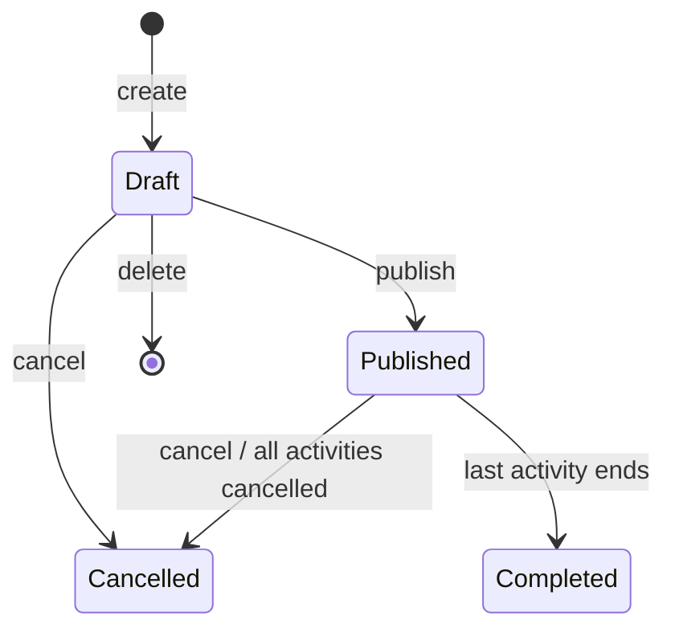
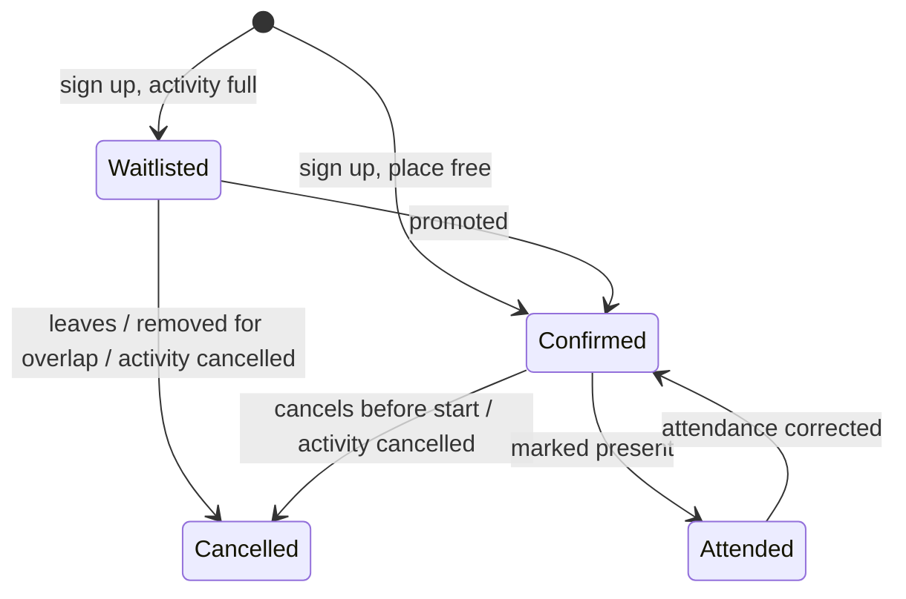
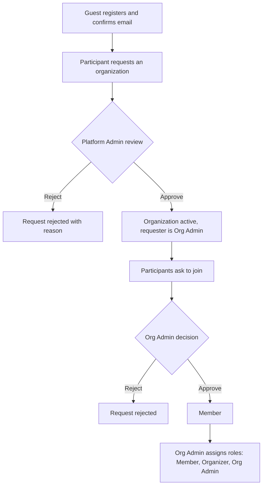
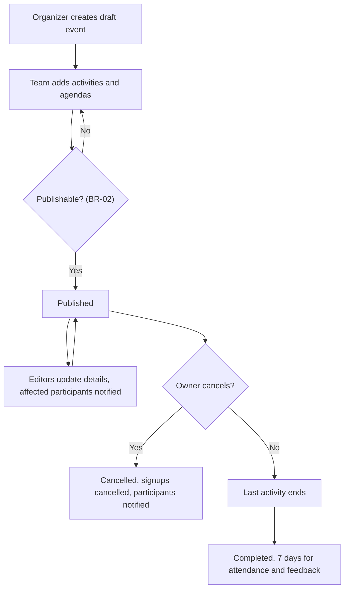
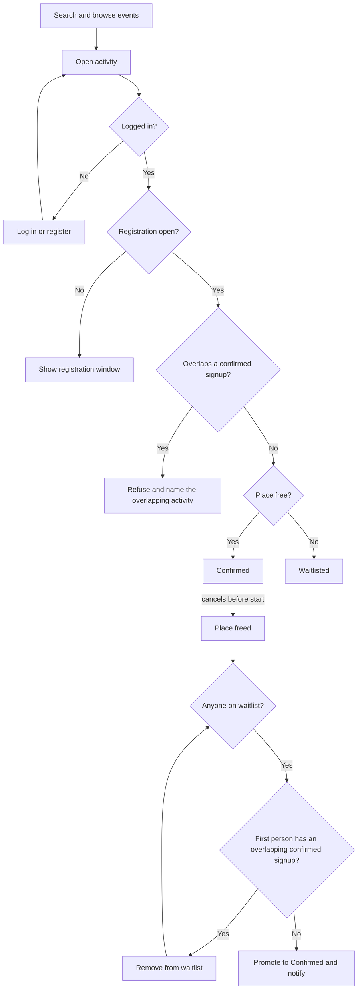
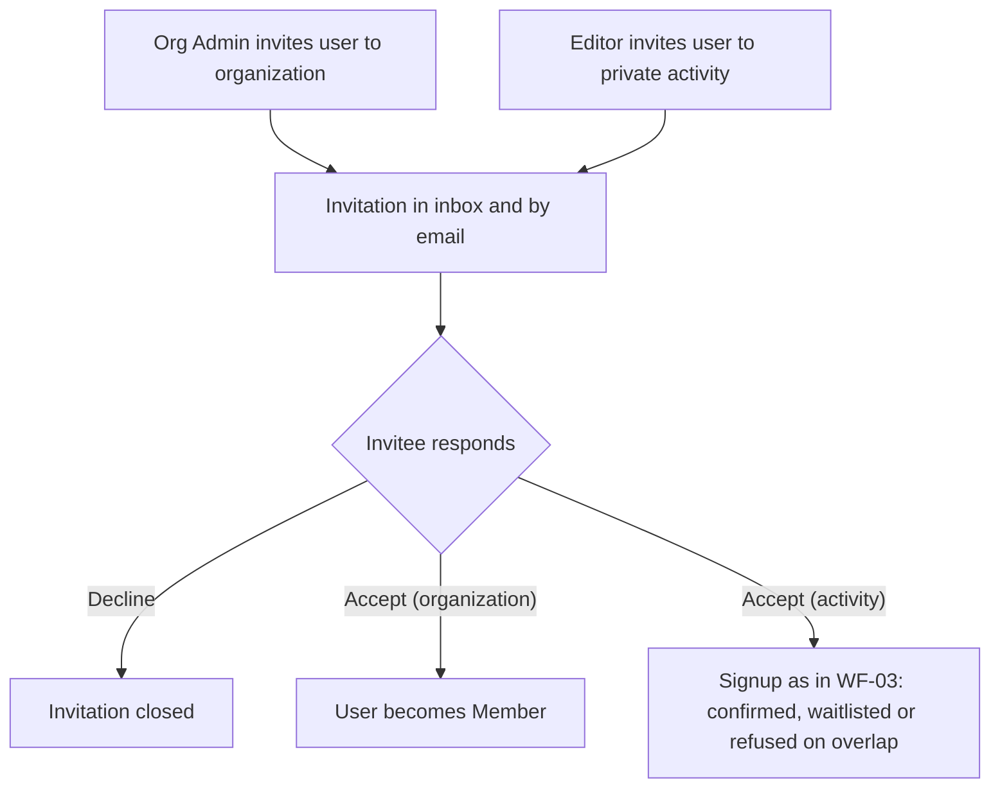
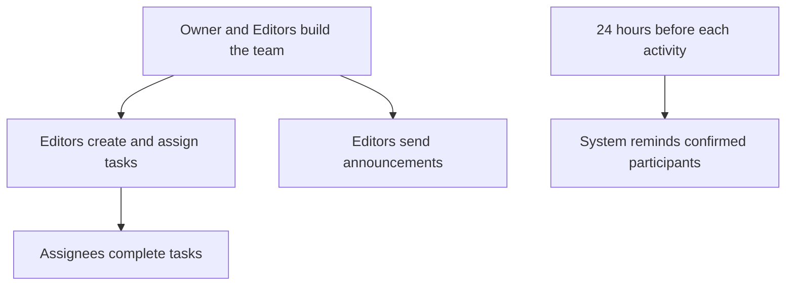
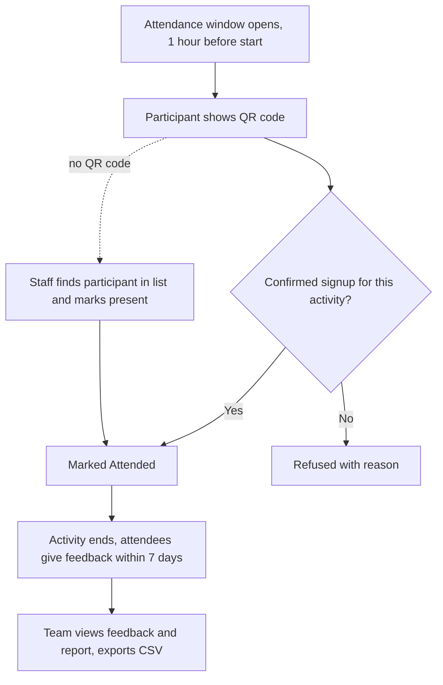

# Main Workflows

A workflow is an end-to-end process made of several use cases.

| ID | Workflow | Use cases | Milestone |
|---|---|---|---|
| WF-01 | Account and organization onboarding | UC-01 – UC-09, UC-31 | Mid-term |
| WF-02 | Event lifecycle | UC-10 – UC-14, UC-19 | Mid-term |
| WF-03 | Discovery and registration | UC-15 – UC-18 | Mid-term |
| WF-04 | Invitations and inbox | UC-20 – UC-23 | Final |
| WF-05 | Event preparation | UC-24 – UC-27 | Final |
| WF-06 | Event day and follow-up | UC-28 – UC-30 | Final |

Parts of WF-01 to WF-03 are delivered in the Final milestone; [User Stories](08-user-stories.md) gives the milestone of each part.

## State machines

### Event

Each activity's registration status (Not yet open, Open, Full, Closed) and timing (upcoming, ongoing, ended) are derived from its dates and capacity, not stored.

### Signup

## WF-01 Account and organization onboarding

A user creates an account, requests an organization, and a Platform Admin approves it. Other users join, and the Org Admin assigns roles.

## WF-02 Event lifecycle

An Organizer drafts an event, the team plans its activities and agendas, and an Editor publishes it. The team keeps it up to date until it completes or is cancelled.

## WF-03 Discovery and registration

People find events and sign up for the activities they want. Waitlists fill freed places automatically.

## WF-04 Invitations and inbox

Org Admins invite users to their organization, and Editors invite users to private activities. Invitations and all other notifications arrive in the inbox and by email.

## WF-05 Event preparation

The event team organizes itself, shares tasks and keeps participants informed.

## WF-06 Event day and follow-up

Staff record attendance, attendees give feedback, and the team reviews the results.

